# Flavrly — Multi-Tenant Food Ordering System & Delivery Platform

[](https://github.com/hariskulkarni/maverick-food-hub/actions/workflows/ci.yml)
[](https://github.com/hariskulkarni/maverick-food-hub/actions/workflows/codeql.yml)


Flavrly is a production-grade, self-hostable food ordering and delivery platform built for the Indian market. One Next.js deployment serves the customer storefront, restaurant admin, kitchen, super-admin platform and a rider web portal; a native Android app (Expo / React Native) serves delivery riders. Many independent restaurants — and parent/child restaurant groups — run side by side on one database with strict tenant isolation.

> **White-label:** the brand name comes from `NEXT_PUBLIC_BRAND_NAME` (default `Flavrly`).

---

## Contents

- [At a glance](#at-a-glance)
- [Overview](#overview)
- [Highlights](#highlights)
- [Surfaces](#surfaces)
- [Features by surface](#features-by-surface)
- [Architecture](#architecture)
- [Multi-tenancy model](#multi-tenancy-model)
- [Order lifecycle](#order-lifecycle)
- [Payments](#payments)
- [Realtime](#realtime)
- [Security model](#security-model)
- [Tech stack](#tech-stack)
- [Codebase charts](#codebase-charts)
- [Testing and CI](#testing-and-ci)
- [Repository layout](#repository-layout)
- [Local development](#local-development)
- [Deployment](#deployment)
- [Environment variables](#environment-variables)
- [Diagram gallery](#diagram-gallery)
- [Further docs](#further-docs)

---

## At a glance

| Metric | Count |
|---|---|
| Web pages (`page.tsx`) | **167** — customer 47 · admin 51 · platform 51 · rider web 10 · kitchen 5 · other 3 |
| API route handlers (`/api/**/route.ts`) | **468** |
| Data model | **152** Prisma models · **89** enums · **33** migrations |
| Server modules (`apps/web/src/server`) | **279** |
| Source size | ~**164k** lines of TypeScript (web) · ~**14k** (rider app) |
| Unit / integration tests | **2,529** passing tests in **274** files (Vitest) |
| Real-PostgreSQL tests | **238** tests in **24** files (`npm run test:db`) |
| End-to-end specs | **24** Playwright specs |

---

## Overview

Each restaurant is a **tenant** with its own branches, menu, staff, riders, offers and settings. Restaurants can be grouped **parent → child**: a parent operates the whole group (orders, riders, reports) from one dashboard with an account switcher. A platform super-admin oversees the network: approvals, commissions, payouts, rider operations, KYC and observability.

Customers discover nearby restaurants, order for **delivery, self-pickup or dine-in** (now or scheduled), pay online (PhonePe, Razorpay) or cash on delivery with wallet and loyalty, and track the order live — including the rider on a map and a delivery OTP. Kitchen staff work a live order board; riders work from the native Android app or the rider web portal.

Production serves two hostnames from one deployment: **`flavrly.in`** for customers and **`portal.flavrly.in`** for staff (admin, kitchen, platform). Middleware enforces which surface each host serves.

---

## Highlights

- **Server-authoritative pricing** — variants, modifiers, happy hours, offers, coupons, freebies, wallet, loyalty and signup bonus are resolved on the server at order time; the cart never dictates price.
- **Strict order state machine** — 22 statuses with an explicit transition table, failure and recovery paths, stuck-order escalation and refunds.
- **Payment safety** — online orders start in `PAYMENT_PENDING` (hidden from the kitchen) and move to `RECEIVED` only after verified capture; unpaid orders fail at 30 minutes and cancel (benefits returned) after 24 hours.
- **Realtime everywhere** — Server-Sent Events with a polling and snapshot safety net, so an order never stays invisible if a stream drops.
- **Google reviews suite** — policy-compliant review requests (no gating, no incentives), reply drafting with a safety filter, negative-review alerts, insights and a weekly digest.
- **Operator tooling** — 10-step restaurant onboarding wizard with a go-live readiness gate, training library with quizzes and certificates, help center with full-text search, observability center and dispatch insights.
- **Rider operations** — KYC verification and gate, incentives, tiers, referrals, shifts, SOS, payouts, and app releases with an in-app update prompt.
- **Defence in depth** — tenant-scoped data access, TOTP for staff, IP allowlist for super-admins, CSRF and rate limiting in middleware, CodeQL `security-extended`, gitleaks and dependency audit in CI.
- **Flavrly PG (direct UPI) — built, switched off** — a self-hosted UPI gateway integration that marks money captured only from matching bank evidence. It is **not activated in production** and holds no bank, NPCI or RBI approval; see [`docs/flavrly-pg/FINAL_GO_NO_GO.md`](docs/flavrly-pg/FINAL_GO_NO_GO.md).

---

## Surfaces

| Surface | Host | Path / app | Sign-in |
|---|---|---|---|
| Public storefront and discovery | `flavrly.in` | `/`, `/restaurants`, `/r/[slug]` | none to browse |
| Customer | `flavrly.in` | `/r/[slug]`, `/cart`, `/checkout`, `/orders`, `/profile` | phone OTP or Google |
| Restaurant admin | `portal.flavrly.in` | `/admin` | email + password (membership role `ADMIN`) |
| Kitchen | `portal.flavrly.in` | `/kitchen` | email + password (membership role `KITCHEN`) |
| Super-admin platform | `portal.flavrly.in` | `/platform` | email + password + TOTP, optional IP allowlist; delegated roles (Admin Assist, Developer, QA, Guest) see only the areas they are granted |
| Rider web portal | web | `/rider` (dashboard, earnings, KYC, shifts, training, help, profile) | rider session |
| Rider app | Android | `apps/rider-native` (Expo) | phone OTP, bearer token |

One `/login` page routes each user to the right surface after sign-in.

---

## Features by surface

### Customer
- Location-first discovery (delivery-radius filter, cuisine chips, sorting) and a CMS-driven discovery page
- Menus with variants/sizes, modifier groups, happy-hour pricing and scheduled category availability
- Delivery, self-pickup, dine-in and scheduled orders; table reservations with optional deposit
- PhonePe and Razorpay online payment, COD, wallet, loyalty points, signup bonus, auto-applied offers and coupons
- Live tracking: status timeline, rider location on a map, delivery OTP, and "Pay now" on the tracker for pending payments
- Saved addresses with map picker, reorder, favourites, ratings and feedback, delivery ETA preview

### Restaurant admin (`/admin`)
- Live orders and kitchen board, KOT and invoices; KOT refuses unpaid orders
- Menu management with bulk CSV/Excel import and export, variants, modifiers, images and scheduling
- Offers, coupons, coupon campaigns, combos, happy hours, challenges, cross-sell, freebies
- Dine-in tables and reservations; order-flow toggles (auto-accept, scheduled, pickup, dine-in); delivery zones
- Riders, rider safety, messaging, reports and analytics, activity log, storefront settings
- **Onboarding wizard** (`/admin/onboarding`): 10 resumable steps with FSSAI/GSTIN/PAN validation, cuisine templates or CSV menu import, delivery presets and a server-checked go-live gate
- **Google reviews** (`/admin/reviews`): review requests by SMS/WhatsApp/email, QR review kit, service-recovery tickets, reply drafting with a safety filter, insights
- Training (`/admin/training`) and help center (`/admin/help`); restaurant groups with a unified parent dashboard

### Kitchen (`/kitchen`)
- New → Accepted → Preparing → Ready board with order chimes, plus training and help

### Super-admin platform (`/platform`)
- Network dashboard, restaurants, orders, users, live ops, live tracking, approvals, brands, IAM
- COD reconciliation, settlements, payouts, rider pay, payment-gateway configuration, signup bonus
- Riders: KYC review, incentives, tiers, referrals, shifts, SOS, incidents, support, rider settings (KYC gate)
- **Observability center**, system health, audit log, security settings (TOTP, IP allowlist, lockout)
- Dispatch insights, surge zones, discovery CMS, reviews analytics, help authoring, training authoring
- App releases for the rider APK, with a download page and in-app update prompt
- Flavrly PG accounts and operations consoles (`/platform/youpi/*`), inactive while the feature flag is off

### Rider (native app and `/rider` web portal)
- Phone-OTP login, online/offline with heartbeat, order pool with self-claim, batch dispatch
- Pickup → delivery flow with Google Maps navigation, background GPS, delivery-OTP check and photo proof
- Earnings, payouts, KYC documents, shifts, training with quizzes and certificates, help with offline cache

---

## Architecture

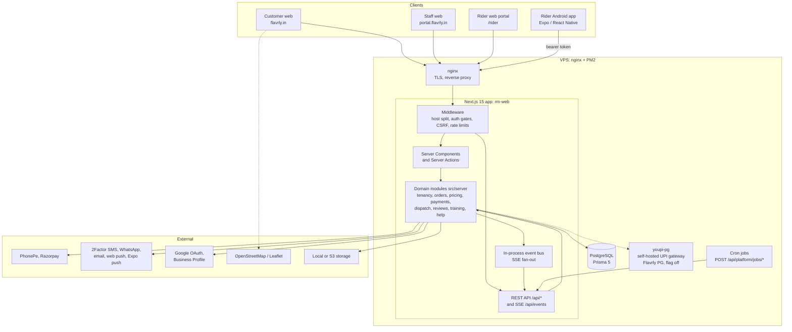

- **One app, many surfaces** — route groups `(customer)`, `admin`, `kitchen`, `platform` and `rider` share one Prisma schema and one set of domain modules in `apps/web/src/server`.
- **Adapters** — payments, SMS/WhatsApp, storage, maps and push sit behind narrow interfaces with mock implementations for local development.
- **Jobs** — review requests and digests, dispatch statistics, observability alerts and retention, escalations, rider heartbeat and the Flavrly PG worker run as POST-only cron routes protected by a constant-time secret check ([`deploy/flavrly-jobs.cron`](deploy/flavrly-jobs.cron)).

See [`docs/ARCHITECTURE.md`](docs/ARCHITECTURE.md) and [`docs/ARCHITECTURE-V2.md`](docs/ARCHITECTURE-V2.md) for the deep dive.

---

## Multi-tenancy model

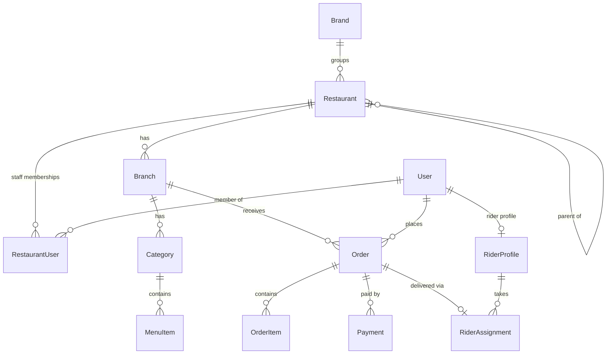

- Staff permissions come from the **membership role** in `RestaurantUser` (ADMIN or KITCHEN), never the global user role — a global admin holding only a kitchen grant is kitchen there (`src/server/tenancy.ts`).
- The active restaurant is chosen with an account-switcher cookie that is honoured only for restaurants the user can access.
- `Restaurant.parentId` forms groups; `src/server/group-scope.ts` resolves every restaurant and branch a parent operates.

---

## Order lifecycle

The transition table lives in `apps/web/src/server/orders.ts`; any other move is rejected.

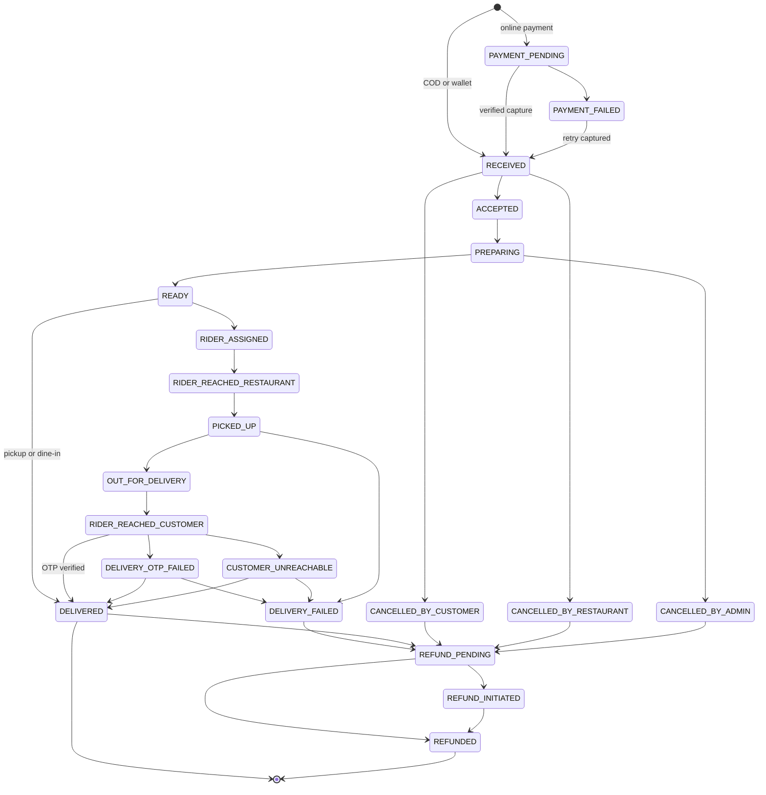

Simplified for readability: admins can also cancel from most pre-delivery states, and `READY` / `RIDER_ASSIGNED` may move straight to `OUT_FOR_DELIVERY`. The table in `orders.ts` is the full set.

---

## Payments

### Online gateways (PhonePe, Razorpay)

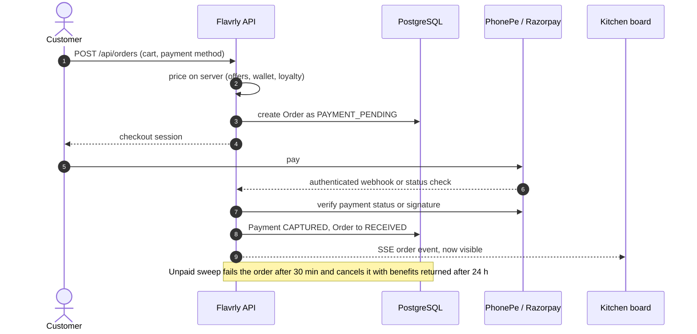

Cash-on-delivery orders and fully wallet-paid (zero-total) orders go straight to `RECEIVED`; COD cash is reconciled per rider on the platform.

### Flavrly PG (direct UPI) — capture only from bank evidence

Engineering complete, **switched off in production** (`FLAVRLY_PG_NEW_PAYMENTS_ENABLED` unset). A gateway "success" is treated as an observation, not as money received.

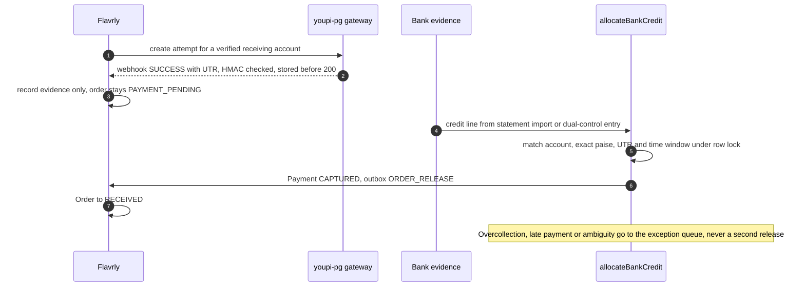

Details: [`docs/flavrly-pg/ARCHITECTURE_AND_DATA_FLOWS.md`](docs/flavrly-pg/ARCHITECTURE_AND_DATA_FLOWS.md), [`docs/flavrly-pg/FINANCIAL_INVARIANTS.md`](docs/flavrly-pg/FINANCIAL_INVARIANTS.md).

---

## Realtime

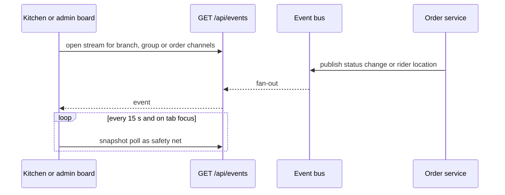

The bus lives in `apps/web/src/server/realtime.ts`; clients fall back to `/api/events/poll`.

---

## Security model

| Area | Control |
|---|---|
| Tenant isolation | Admin and kitchen data access scoped through `tenancy.ts` membership roles; caller-supplied ids re-checked on the server |
| Authentication | NextAuth v5; Argon2id passwords; phone OTP with attempt limits; single active session per user; login history |
| Staff 2FA | TOTP for super-admins and platform roles with recovery codes; optional IP allowlist and lockout (`src/server/2fa.ts`) |
| Request hygiene | Host-split middleware, `Sec-Fetch-Site: cross-site` CSRF block, per-IP / per-user / auth-path rate limits with backoff |
| Webhooks and jobs | Signature or HMAC verification, exact webhook path allowlist, POST-only cron routes with a constant-time secret |
| Money | Server-side pricing, `PAYMENT_PENDING` gating, atomic wallet and points debits, bank-evidence-only capture for Flavrly PG |
| Supply chain | CodeQL `security-extended` on every PR, gitleaks secret scan, `npm audit` gate, SHA-pinned GitHub Actions |
| Data | KYC files in private storage, no PII in order logs, pinned VPS host key for deploys |

Payments threat model: [`docs/flavrly-pg/SECURITY_THREAT_MODEL.md`](docs/flavrly-pg/SECURITY_THREAT_MODEL.md).

---

## Tech stack

| Layer | Technology |
|---|---|
| Web framework | Next.js 15.5 (App Router), React 19, TypeScript |
| UI | Tailwind CSS 3.4, shadcn-style components, lucide-react, Recharts, Sonner |
| Data | PostgreSQL 15+, Prisma 5.22 (`prisma migrate deploy`) |
| Validation | zod 4 |
| Auth | NextAuth v5 (beta.32), Argon2id, otplib (TOTP) |
| Realtime | Server-Sent Events over an in-process event bus |
| Payments | PhonePe Standard Checkout, Razorpay, COD, wallet and loyalty; Flavrly PG direct UPI (off) |
| Messaging | 2Factor SMS/OTP, Meta WhatsApp, email (nodemailer), web push, Expo push |
| Maps | Leaflet + OpenStreetMap (web), react-native-maps with Google Maps navigation (rider) |
| Files | Local or S3-compatible storage, sharp, ExcelJS |
| Logging | pino |
| Rider app | Expo SDK 54, React Native 0.81, expo-router, expo-location, EAS Build |
| Testing | Vitest, Playwright, real-PostgreSQL integration suite |
| Hosting | VPS, nginx, PM2, Node 20 LTS, GitHub Actions |

---

## Codebase charts

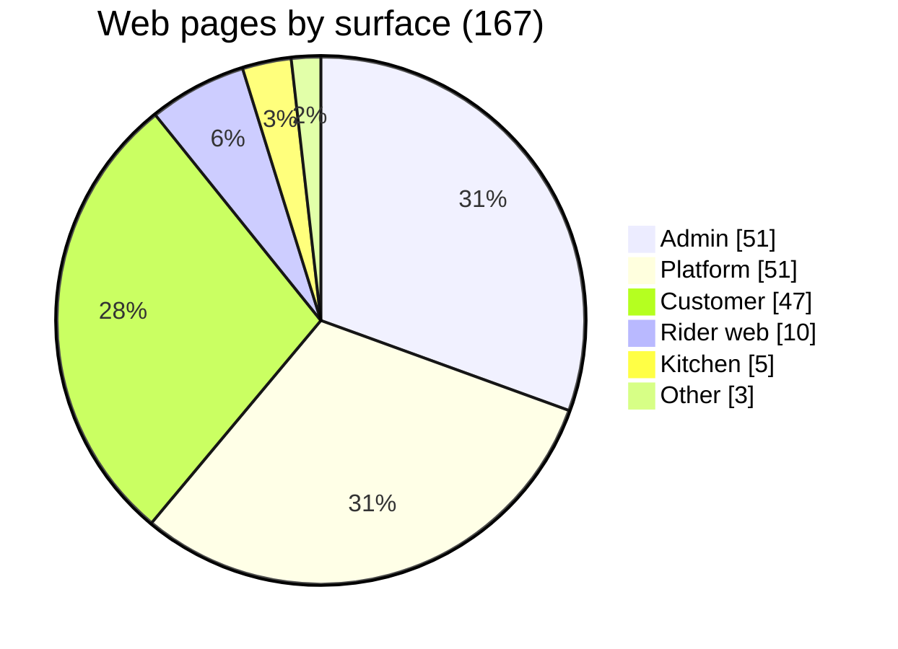

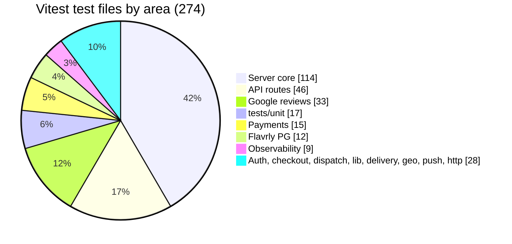

---

## Testing and CI

```bash
cd apps/web
npm run typecheck          # tsc --noEmit
npm run lint               # next lint
npm run check:responsive   # responsive-layout guardrail
npm run test:ci            # Vitest unit + integration
DATABASE_URL="postgresql://ci@localhost:5432/ci_local?schema=public" npm run test:db   # real PostgreSQL
npm run test:e2e           # Playwright end-to-end
```

`test:db` resets the target database and refuses any URL that is not on localhost with a database name starting with `ci`. Money-critical invariants (unique allocation, row locks, concurrent wallet debits) are proven there against real PostgreSQL. The rider app is checked with `cd apps/rider-native && npm run typecheck && npm run lint`.

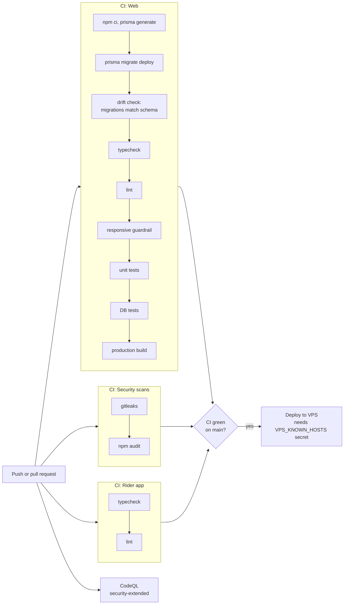

---

## Repository layout

```
.
├── apps/
│   ├── web/                       Next.js app: every web surface + API
│   │   ├── src/app/
│   │   │   ├── (customer)/        storefront, discovery, cart, checkout, orders, profile
│   │   │   ├── admin/             restaurant admin
│   │   │   ├── kitchen/           kitchen board
│   │   │   ├── platform/          super-admin platform
│   │   │   ├── rider/             rider web portal
│   │   │   ├── login/             role-aware sign-in
│   │   │   └── api/               REST + SSE + webhooks + jobs
│   │   ├── src/server/            domain modules (tenancy, orders, payments, pg, dispatch,
│   │   │                          reviews, training, help, observability, notifications, ...)
│   │   ├── src/components/, src/lib/
│   │   ├── prisma/                schema.prisma, migrations/, seeds
│   │   ├── __tests__/, tests/     Vitest suites (tests/db = real PostgreSQL)
│   │   └── e2e/                   Playwright specs
│   └── rider-native/              Expo / React Native rider app
├── deploy/                        nginx, cron jobs, backups, production env example
├── docs/                          architecture, runbooks, flavrly-pg/, diagrams
├── scripts/                       deploy-remote.sh, go-live.sh, checks, pg-uat/
├── .github/workflows/             ci.yml, codeql.yml, deploy.yml
├── docker-compose.yml, Dockerfile
└── README.md
```

---

## Local development

Requires **Node 20+** and **PostgreSQL 15+** (or Docker).

```bash
# Option A: Docker (Postgres + app)
docker compose up --build

# Option B: local
cd apps/web
cp .env.example .env            # set DATABASE_URL, NEXTAUTH_SECRET, ...
npm install
npx prisma migrate deploy       # apply migrations
npm run db:seed                 # sample restaurants, menu, users
npm run dev                     # http://localhost:3000
```

Integrations fall back to mock adapters when keys are absent, so the app runs locally without third-party accounts. In development, phone OTP codes are printed to the server console. Demo accounts are listed in [`docs/DEMO-ACCOUNTS.md`](docs/DEMO-ACCOUNTS.md) — local seeds only, never for production.

---

## Deployment

Reference target: one VPS with **PostgreSQL, nginx and PM2** (process `rm-web`), repo at `/opt/restaurant-manager`.

- **Releases** follow [`docs/GO_LIVE_RUNBOOK.md`](docs/GO_LIVE_RUNBOOK.md) with `scripts/go-live.sh`: `preflight` (read-only) → `backup` → `migrate` (`prisma migrate deploy`, with a one-time baseline for databases created by `db push`) → `deploy` → `post`. Every changing step asks for confirmation; rollback is `go-live.sh rollback <sha>`.
- **Continuous deploy** (`.github/workflows/deploy.yml`) runs only after CI passes on `main`, over SSH with a pinned host key (`VPS_KNOWN_HOSTS`). Schema changes are applied only on a manual dispatch with `migrate=true`.
- **Rider app** builds with EAS — see [`apps/rider-native/BUILD.md`](apps/rider-native/BUILD.md) — and is published from `/platform/app-releases`.
- **Background jobs** are installed from [`deploy/flavrly-jobs.cron`](deploy/flavrly-jobs.cron).

More: [`docs/PRODUCTION-DEPLOY.md`](docs/PRODUCTION-DEPLOY.md), [`docs/DEPLOY-INDIA.md`](docs/DEPLOY-INDIA.md), [`docs/flavrly-pg/DEPLOYMENT_AND_ROLLBACK.md`](docs/flavrly-pg/DEPLOYMENT_AND_ROLLBACK.md).

---

## Environment variables

Full list: [`apps/web/.env.example`](apps/web/.env.example) and [`deploy/.env.production.example`](deploy/.env.production.example).

| Variable | Purpose |
|---|---|
| `DATABASE_URL` | PostgreSQL connection string |
| `NEXTAUTH_URL`, `NEXTAUTH_SECRET` | Auth base URL and signing secret |
| `NEXT_PUBLIC_BRAND_NAME` | White-label platform name (default `Flavrly`) |
| `PUBLIC_HOST`, `PORTAL_HOST` | Customer and staff hostnames (default `flavrly.in`, `portal.flavrly.in`) |
| `GOOGLE_CLIENT_ID`, `GOOGLE_CLIENT_SECRET` | Customer Google sign-in |
| `GOOGLE_OAUTH_CLIENT_ID`, `GOOGLE_OAUTH_CLIENT_SECRET`, `GOOGLE_OAUTH_REDIRECT_URI` | Google Business Profile (reviews) |
| `GOOGLE_MAPS_API_KEY`, `GOOGLE_PLACES_API_KEY` | Maps and Places features |
| `PHONEPE_CLIENT_ID`, `PHONEPE_CLIENT_SECRET`, `PHONEPE_WEBHOOK_USERNAME`, `PHONEPE_WEBHOOK_PASSWORD` | PhonePe checkout and webhook authentication |
| `RAZORPAY_KEY_ID`, `RAZORPAY_KEY_SECRET`, `RAZORPAY_WEBHOOK_SECRET` | Razorpay checkout and webhooks |
| `NOTIFIER_SMS`, `TWOFACTOR_API_KEY` | SMS / OTP delivery |
| `STORAGE_DRIVER` | File storage (local or S3) |
| `INTERNAL_CRON_SECRET` | Authenticates cron job routes |
| `FLAVRLY_PG_NEW_PAYMENTS_ENABLED` | Flavrly PG direct UPI — keep unset/false in production |

---

## Diagram gallery

Generated by [`docs/gen-diagrams.py`](docs/gen-diagrams.py) (`python3 docs/gen-diagrams.py`, needs `cairosvg`).

### System architecture
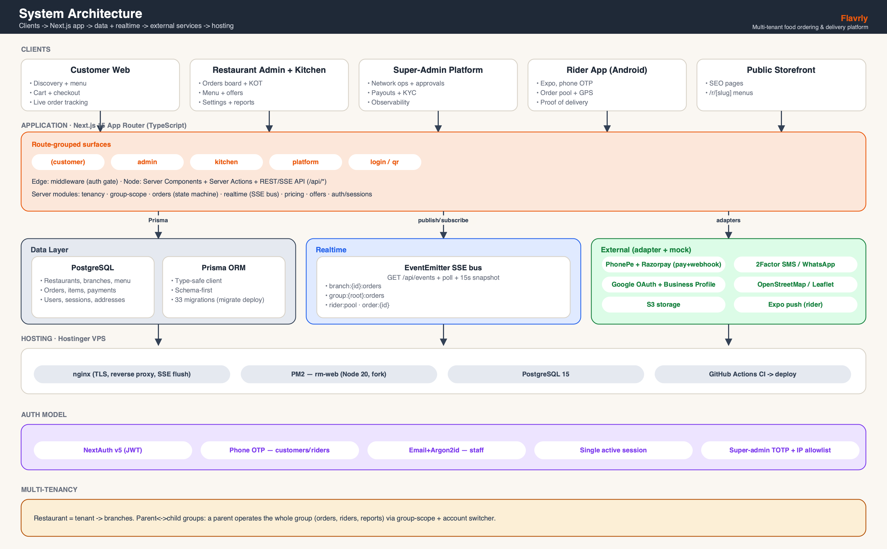

### Technical architecture
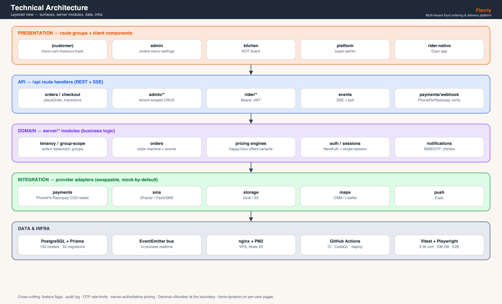

### Data flow: place order
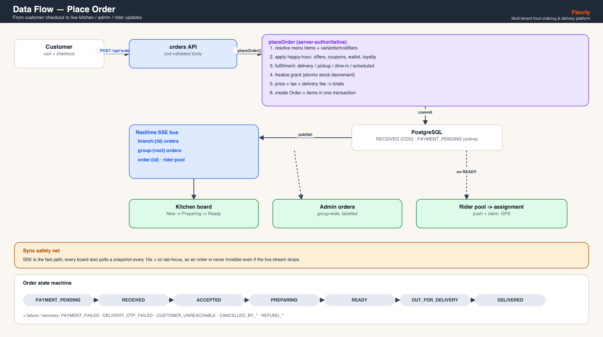

### Third-party integrations
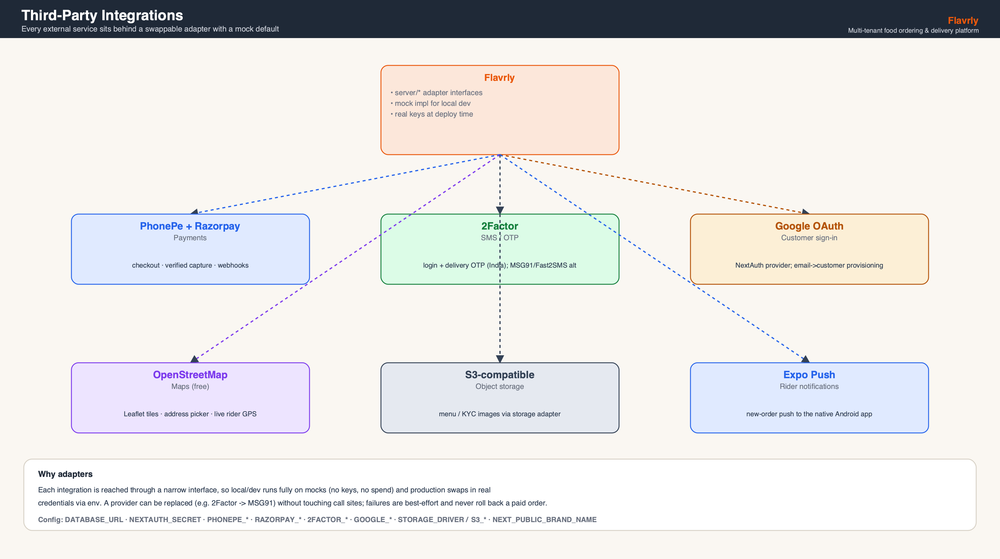

### End-to-end order flow
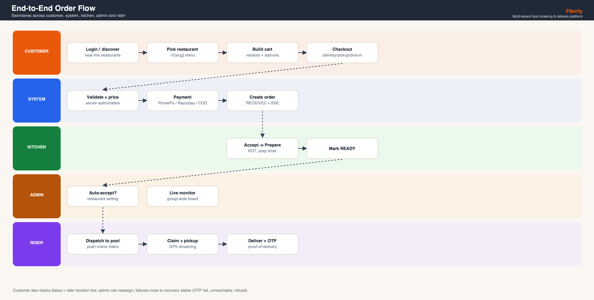

---

## Further docs

| Topic | Documents |
|---|---|
| Architecture | [`ARCHITECTURE.md`](docs/ARCHITECTURE.md), [`ARCHITECTURE-V2.md`](docs/ARCHITECTURE-V2.md), [`API.md`](docs/API.md), [`SUBDOMAIN-TENANCY.md`](docs/SUBDOMAIN-TENANCY.md), [`iam.md`](docs/iam.md) |
| Operations | [`GO_LIVE_RUNBOOK.md`](docs/GO_LIVE_RUNBOOK.md), [`PRODUCTION-DEPLOY.md`](docs/PRODUCTION-DEPLOY.md), [`DEPLOY-INDIA.md`](docs/DEPLOY-INDIA.md), [`GIT-BACKUP.md`](docs/GIT-BACKUP.md) |
| Payments | [`PHONEPE-INTEGRATION.md`](docs/PHONEPE-INTEGRATION.md), [`flavrly-pg/`](docs/flavrly-pg/) (go/no-go, invariants, reconciliation, threat model, runbook) |
| Features | [`GOOGLE-REVIEWS-SETUP.md`](docs/GOOGLE-REVIEWS-SETUP.md), [`KYC-VERIFICATION.md`](docs/KYC-VERIFICATION.md), [`ROADMAP.md`](docs/ROADMAP.md) |
| Security and compliance | [`security-audit.md`](docs/security-audit.md), [`rate-limiting.md`](docs/rate-limiting.md), [`legal-privacy-compliance.md`](docs/legal-privacy-compliance.md) |
| Quality | [`QA-TEST-PLAN.md`](docs/QA-TEST-PLAN.md), [`flavrly-pg/TEST_EVIDENCE.md`](docs/flavrly-pg/TEST_EVIDENCE.md) |

---

## License

MIT.
